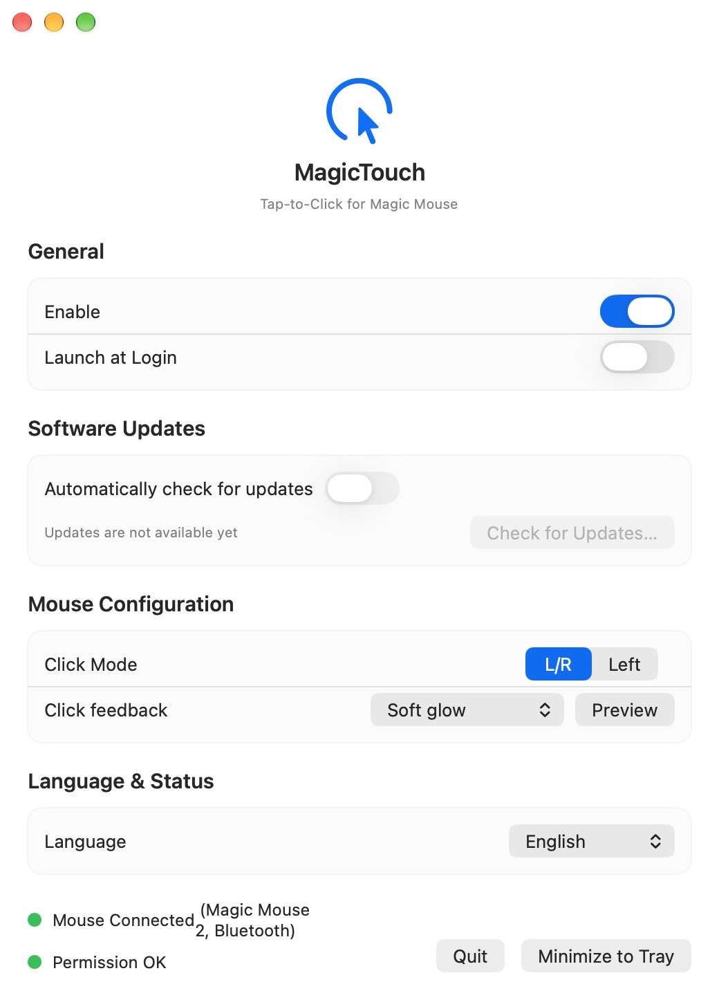

# MagicTouch

English | [简体中文](README.zh-CN.md)

Tap to click on your Magic Mouse, without pressing down.

MagicTouch is a macOS menu bar app that turns light taps on an Apple Magic Mouse into mouse clicks.

<p align="center">
  
</p>

## Features

- **Tap to click**: Recognizes taps on the Magic Mouse surface while distinguishing them from scrolling gestures.
- **Two click modes**: Use the left and right sides for their respective mouse buttons, or make every tap a left click.
- **Consecutive clicks**: Supports double-click and consecutive-click recognition.
- **Optional visual feedback**: Choose an expanding ring, contracting ring, soft glow, or dot. Preview effects in settings or turn them off entirely.
- **Menu bar controls**: Enable or pause tap detection and keep the app running after closing the settings window.
- **Launch at login**: Optionally start MagicTouch when you sign in.
- **Device and permission status**: See the connected mouse model and Accessibility permission status.
- **Multiple languages**: English, Simplified Chinese, Japanese, Korean, French, and Spanish, with an option to follow the system language.

## Requirements

- macOS 14 Sonoma or later.
- Apple Magic Mouse. Device detection includes the original Magic Mouse, Magic Mouse 2 (Lightning), and the USB-C model.
- macOS **Accessibility** permission to send simulated mouse clicks.

MagicTouch reads touch events through Apple's private `MultitouchSupport.framework`.
Compatibility needs to be verified on each mouse model and macOS version; system updates may affect behavior.
The app only processes devices identified as Magic Mouse. It does not add tap-to-click to trackpads or other mice.

## Install and use

1. Download a DMG from [Releases](https://github.com/cadl/MagicTouch/releases). If no installer is available yet, build from source using the instructions below.
2. Open the DMG and drag `MagicTouch.app` into **Applications**.
3. Launch MagicTouch and allow it in **System Settings → Privacy & Security → Accessibility**.
4. Make sure your mouse is connected, enable MagicTouch, and choose a click mode.
5. Optionally select a visual feedback effect. Choose **Off** to disable it.

You can minimize the settings window to the menu bar and keep MagicTouch running. To stop tap detection, disable it in settings or quit the app.

Restart the app when prompted after changing its language. Move the app into Applications before enabling launch at login.

## FAQ

**Why aren't my taps registering?**

Check that your Magic Mouse is connected, MagicTouch is enabled, and Accessibility permission has been granted.
After reinstalling or switching between Debug and Release builds, you may need to check permission for each app separately.
If taps still do not register, quit and reopen MagicTouch.

**Why are software updates unavailable?**

MagicTouch integrates Sparkle, but updating is enabled only in builds configured with a valid update feed and public key.
Otherwise, download new versions manually from GitHub Releases.

**How do I report accidental clicks or compatibility issues?**

Disable tap detection if needed, then open an [issue](https://github.com/cadl/MagicTouch/issues) with your macOS version, mouse model, app version, and steps to reproduce the problem.
Review screenshots and logs for personal information before sharing them.

## Build from source

Install Xcode, then clone and open the project:

```sh
git clone https://github.com/cadl/MagicTouch.git
cd MagicTouch
open MagicTouch.xcodeproj
```

Select the shared `MagicTouch` scheme, choose your own development team under **Signing & Capabilities**, and build and run.
Keep personal signing configuration out of commits. Swift Package Manager resolves the Sparkle dependency.

To check compilation without code signing:

```sh
xcodebuild -project MagicTouch.xcodeproj -scheme MagicTouch \
  -configuration Debug -derivedDataPath .derivedData CODE_SIGNING_ALLOWED=NO build
```

After configuring local signing, run unit tests:

```sh
xcodebuild test -project MagicTouch.xcodeproj -scheme MagicTouch \
  -destination 'platform=macOS' -only-testing:MagicTouchTests
```

## Development and release documentation

- [Building and signing](BUILD_GUIDE.md)
- [Xcode Cloud → GitHub DMG releases](docs/RELEASE.md)
- [Sparkle update configuration](docs/UPDATES.md) (Chinese)
- [Repository and contribution guidelines](AGENTS.md)

The release pipeline uses Xcode Cloud to sign and notarize the app, then GitHub Actions to package it into a DMG and upload it to a draft Release.
Apple and GitHub setup is required before use. The outer DMG is unsigned; the app inside retains its signature and notarization ticket.
