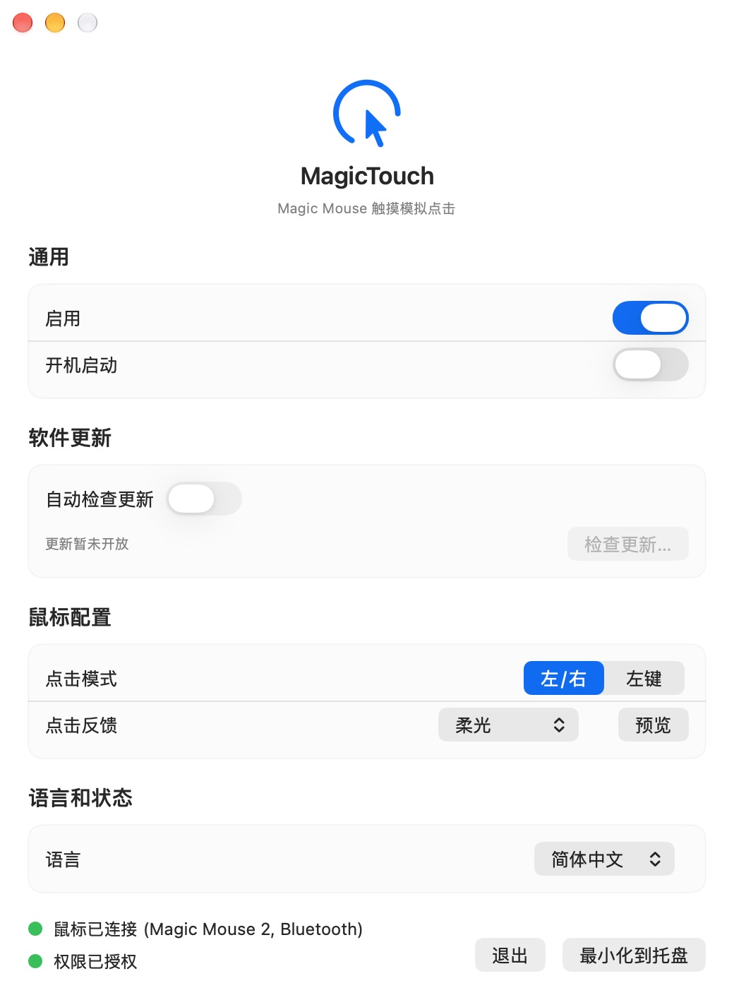

# MagicTouch

让 Magic Mouse 支持轻触点击，无需按下鼠标。

A macOS menu bar app that brings tap-to-click to Apple Magic Mouse.

<p align="center">
  
</p>

## 功能

- **轻触点击**：将 Magic Mouse 表面的轻触转换为鼠标点击，区分轻触与滚动操作。
- **两种点击模式**：左右模式下，轻触左侧为左键、右侧为右键；仅左键模式下，轻触任意位置均为左键。
- **连续点击**：支持双击和连续点击识别。
- **可选视觉反馈**：扩散圆环、收紧圆环、柔光、小点，可随时关闭；设置中提供预览。
- **菜单栏常驻**：随时启用或暂停，关闭设置窗口后仍可在菜单栏管理。
- **开机启动**：可在设置中开启登录后启动。
- **设备与权限状态**：显示 Magic Mouse 连接状态、型号和辅助功能授权状态。
- **多语言**：简体中文、英语、日语、韩语、法语、西班牙语，也可跟随系统语言。

## 系统要求

- macOS 14 Sonoma 或更新版本。
- Apple Magic Mouse。设备识别覆盖 Magic Mouse、Magic Mouse 2（Lightning）和 USB-C 型号。
- macOS **辅助功能**权限，用于向系统发送模拟鼠标点击。

MagicTouch 使用 Apple 的私有 `MultitouchSupport.framework` 读取触摸事件。
不同鼠标型号和 macOS 版本的兼容性仍需实际验证，系统升级可能影响行为。
应用只处理识别为 Magic Mouse 的设备，不为触控板或普通鼠标添加轻触点击。

## 安装与使用

1. 在 [Releases](https://github.com/cadl/MagicTouch/releases) 下载对应版本的 DMG。如果暂无安装包，可按下方说明从源码构建。
2. 打开 DMG，将 `MagicTouch.app` 拖入 **Applications（应用程序）**。
3. 启动 MagicTouch，在 **系统设置 → 隐私与安全性 → 辅助功能** 中允许 MagicTouch。
4. 确认鼠标已连接，在应用中打开「启用」，选择点击模式。
5. 按需选择点击反馈；不希望显示效果时选择「关闭」。

设置窗口可最小化到菜单栏，应用会继续运行。需要停止时，在设置中关闭「启用」，或退出应用。

切换界面语言后，需要按提示重启应用。开启「开机启动」前，请先将应用移至 Applications 文件夹。

## 常见问题

**轻触没有触发点击？**

检查 Magic Mouse 是否已连接、MagicTouch 是否已启用，以及辅助功能权限是否已授权。
重新安装或切换 Debug / Release 构建后，可能需要分别确认对应应用的权限。
若仍无法使用，可退出并重新启动 MagicTouch。

**为什么显示「更新暂未开放」？**

应用集成了 Sparkle，但只有构建配置了有效更新地址和公钥后才会启用更新功能。
未配置时，可从 GitHub Releases 手动下载新版。

**遇到误触或某个系统版本不兼容怎么办？**

可以先关闭「启用」，然后在 [Issues](https://github.com/cadl/MagicTouch/issues) 中提供 macOS 版本、鼠标型号、应用版本和复现步骤。
提交截图或日志前，请检查并移除个人信息。

## 从源码构建

安装 Xcode，然后克隆并打开项目：

```sh
git clone https://github.com/cadl/MagicTouch.git
cd MagicTouch
open MagicTouch.xcodeproj
```

选择共享的 `MagicTouch` Scheme，在 **Signing & Capabilities** 中选择自己的开发团队，再构建运行。
个人签名配置不要提交到仓库。依赖的 Sparkle 由 Swift Package Manager 解析。

仅检查编译、不进行代码签名：

```sh
xcodebuild -project MagicTouch.xcodeproj -scheme MagicTouch \
  -configuration Debug -derivedDataPath .derivedData CODE_SIGNING_ALLOWED=NO build
```

配置本地签名后，运行单元测试：

```sh
xcodebuild test -project MagicTouch.xcodeproj -scheme MagicTouch \
  -destination 'platform=macOS' -only-testing:MagicTouchTests
```

## 开发与发布文档

- [构建与签名](BUILD_GUIDE.md)
- [Xcode Cloud → GitHub DMG 发布流程](docs/RELEASE.md)
- [Sparkle 自动更新配置](docs/UPDATES.md)
- [代码组织与贡献规范](AGENTS.md)

发布流水线由 Xcode Cloud 完成 App 签名和公证，GitHub Actions 将其制作成 DMG 并上传草稿 Release。
使用前需要完成 Apple 和 GitHub 后台配置；外层 DMG 本身不签名，内部 App 保留签名和公证票据。
